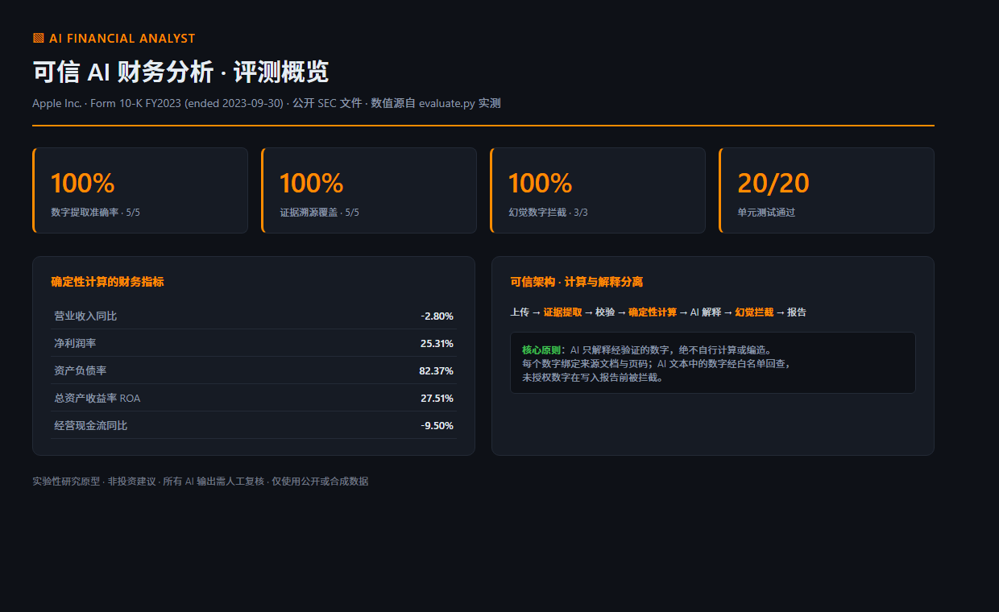

# AI Financial Analyst

> A trustworthy AI prototype that reads public-company financial reports, extracts
> figures **with evidence**, computes ratios with **deterministic functions**, and
> generates **AI-assisted, fact-checked analysis** — with a hallucination guard that
> blocks any number the model did not derive from verified data.

[](https://www.python.org/)
[](https://streamlit.io/)
[](tests/)
[](LICENSE)

---

## Overview

Most "AI finance" demos let a language model both read numbers **and** do the math —
then present the confidently-worded result as fact. That is exactly how financial
tools fail: the model invents a plausible-looking figure and nobody notices.

This project takes the opposite approach. It is built around one principle:

> **The LLM may explain, but it may never compute or invent a number.**

Arithmetic lives in pure, unit-tested functions. Every extracted figure carries the
document name and page it came from. Every sentence the AI writes is scanned, and any
number not on the verified allow-list is **blocked before it reaches the report**.

The result is a small but serious prototype of *how AI should be used in a regulated,
evidence-driven domain*.



*Dashboard above is generated from the actual `evaluate.py` output — the numbers are
measured, not illustrative.*

---

## Key features

| # | Feature | What makes it non-trivial |
|---|---------|---------------------------|
| 1 | **Financial report ingestion** | PDF / XLSX / CSV, with fiscal-period detection |
| 2 | **Evidence-backed extraction** | Every figure records document + page + raw snippet |
| 3 | **Deterministic ratio engine** | Pure functions, hand-computed expected values in tests |
| 4 | **AI analysis with a hallucination guard** | Numeric allow-list validation; invented numbers are blocked |
| 5 | **Traceable report export** | HTML (interactive Plotly) + PDF, with an evidence appendix |

### The trust boundary

```
Upload → Extract (+evidence) → Verify → Compute (pure) → Interpret (LLM) → Guard → Report
                                          │                              │
                                     unit tests                  numeric allow-list
```

- **Computation** (`financial_metrics.py`) — no LLM, no I/O, fully tested.
- **Interpretation** (`ai_analyst.py`) — sees only verified figures and metrics.
- **Validation** (`hallucination_guard.py`) — defense-in-depth against fabricated numbers.

See [docs/architecture.md](docs/architecture.md) and [docs/methodology.md](docs/methodology.md).

---

## Research objectives

The project explores how an AI agent can improve financial-analysis workflows **without
sacrificing accuracy, reliability, or traceability** — the three properties that matter
most when a system's output informs a decision.

---

## Evaluation

Evaluated against a hand-verified sample from a **public Apple Inc. Form 10-K**
(fiscal year ended 2023-09-30). Reproduce with `python evaluate.py`:

| Metric | Result |
|--------|--------|
| Extraction accuracy (5 key figures) | **100%** (5/5) |
| Evidence coverage (page references) | **100%** (5/5) |
| Hallucination block rate (injected fakes) | **100%** (3/3) |
| Unit tests passing | **20/20** |

> These numbers describe performance on the single demo filing, not on arbitrary
> reports. See [Limitations](#limitations).

---

## Technology stack

- Python 3.11+
- Streamlit (UI) · Pandas (tables) · Plotly (charts)
- pdfplumber + PyMuPDF (document parsing) · Pydantic (typed contracts)
- reportlab (PDF export) · pytest (testing)
- Configurable LLM provider: **mock by default**, OpenAI-compatible via env vars

---

## Quick start

```bash
# 1. Clone and enter
git clone https://github.com/davidwuphp-a11y/ai-financial-analyst.git
cd ai-financial-analyst

# 2. Create a virtual environment
python -m venv .venv
source .venv/bin/activate        # Windows: .venv\Scripts\activate

# 3. Install dependencies
pip install -r requirements.txt

# 4. Run the app
streamlit run app.py

# 5. Run tests / evaluation
pytest tests/ -q
python evaluate.py
```

The app opens with the built-in Apple FY2023 sample loaded, so it is useful immediately
with no upload and no API key.

### Enabling a real LLM (optional)

```bash
export AI_PROVIDER=openai
export AI_API_KEY=your_key_here
export AI_BASE_URL=https://api.openai.com/v1   # or any compatible endpoint
export AI_MODEL=gpt-4o-mini
```

Without these variables the app runs the deterministic **mock provider** — no cost,
no network, fully reproducible.

---

## Project structure

```
ai-financial-analyst/
├── README.md
├── requirements.md              # requirements specification
├── requirements.txt
├── evaluate.py                  # reproducible benchmark harness
├── app.py                       # Streamlit UI (thin orchestration layer)
├── src/
│   ├── models.py                # Pydantic contracts (Figure, Metric, Claim, Evidence)
│   ├── document_reader.py       # PDF/XLSX/CSV ingestion + evidence extraction
│   ├── financial_metrics.py     # pure calculation functions (the numeric core)
│   ├── hallucination_guard.py   # numeric allow-list validation
│   ├── ai_analyst.py            # swappable LLM provider + interpretation
│   └── report_generator.py      # HTML + PDF report export
├── data/sample_data/
│   ├── apple_10k_2023.pdf       # public SEC filing (demo sample)
│   └── golden_figures.json      # hand-verified reference values
├── tests/
│   ├── test_financial_metrics.py
│   ├── test_extraction.py
│   └── test_hallucination_guard.py
└── docs/
    ├── architecture.md
    ├── methodology.md
    └── adr/                     # architecture decision records
```

---

## Limitations

- Extraction is tuned for the demo filing's table layout. Arbitrary or **scanned** PDFs
  are **not** reliably supported in v1. The system reports "not found" rather than guessing.
- The default AI provider is a mock; real interpretation needs an API key.
- This is an experimental prototype, **not** a regulated financial advisory system.
  AI-generated explanations require human review and do not constitute investment advice.
- All figures are from public or synthetic sources; no confidential material is used.

---

## Author

**David Wu** — product leader with a fintech + AI background.

This project is a personal exploration of trustworthy AI applied to financial workflows.
